# How DOC-MON Works

A short recap of how the system works and how everything flows. For setup, see [DOC-MON.md](DOC-MON.md).

> **Seeing the diagrams:** GitHub draws them automatically. In VS Code, install the **Markdown Preview Mermaid Support** extension, then press `Ctrl + Shift + V`.

---

## 1. The big idea

**DOC-MON is parcel tracking for paper documents.**

A courier app doesn't carry your parcel. It only tells you where the parcel is and who has it. DOC-MON does the same for resolutions, proposals and budgets: the papers are still real and carried by hand, and DOC-MON tracks them.

| Parcel tracking | DOC-MON |
|---|---|
| Order | **Ticket** (one request) |
| Item in the order | **Document** / paper |
| Delivery stops | **Steps** on the approval route |
| Courier at each stop | **Signatory** |
| Tracking history | **Document actions** |

A ticket with one paper is **Single**. A ticket with several is a **Batch**, and each paper in it moves on its own.

---

## 2. Who does what

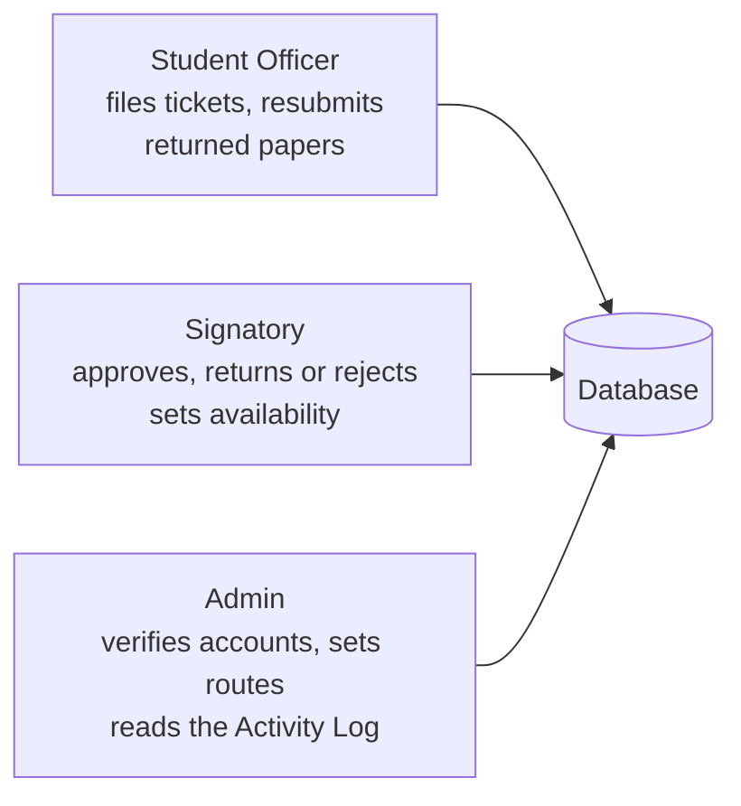

- Officers of the same organization **share** its tickets, so the Deputy can carry on for the Secretary.
- Each organization has its own **route**, the ordered list of its signatories. DIGITS uses Adviser → SSC President → ODSOA → VPSD.
- The **last step** on the route has the final say.

---

## 3. The whole system at a glance

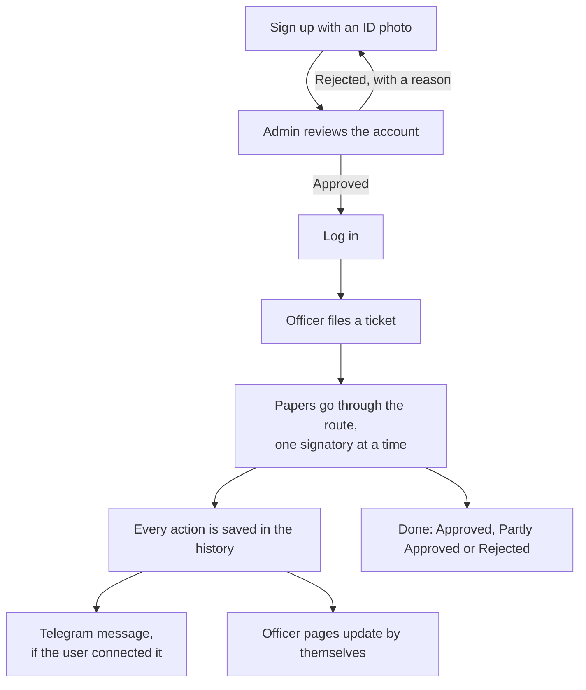

---

## 4. What happens when you click something

Every click takes the same trip. Think of a restaurant:

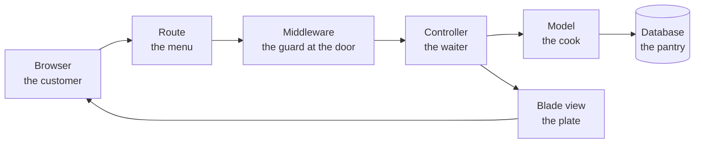

| Stop | Job | Where |
|---|---|---|
| **Route** | Matches the address to a controller | `routes/web.php` |
| **Middleware** | Are you logged in? Is this your role? Did you accept the privacy notice? | `app/Http/Middleware/` |
| **Controller** | Checks the input and coordinates the work | `app/Http/Controllers/` |
| **Model** | Holds the rules and talks to the database | `app/Models/` |
| **View** | Builds the page you see | `resources/views/` |

---

## 5. Life of an account

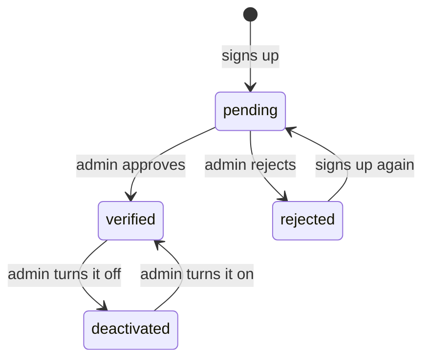

- Only **verified** accounts can log in.
- Signing up needs **consent** to the [Privacy Notice](https://doc-mon-system.onrender.com/privacy). Accounts older than that notice accept it once, at their next log-in.
- The ID photo is **deleted** right after the admin's review.
- Once a year, the admin reviews accounts older than 4 years.
- Admins aren't created through sign-up.

---

## 6. Life of a paper

This is the heart of DOC-MON.

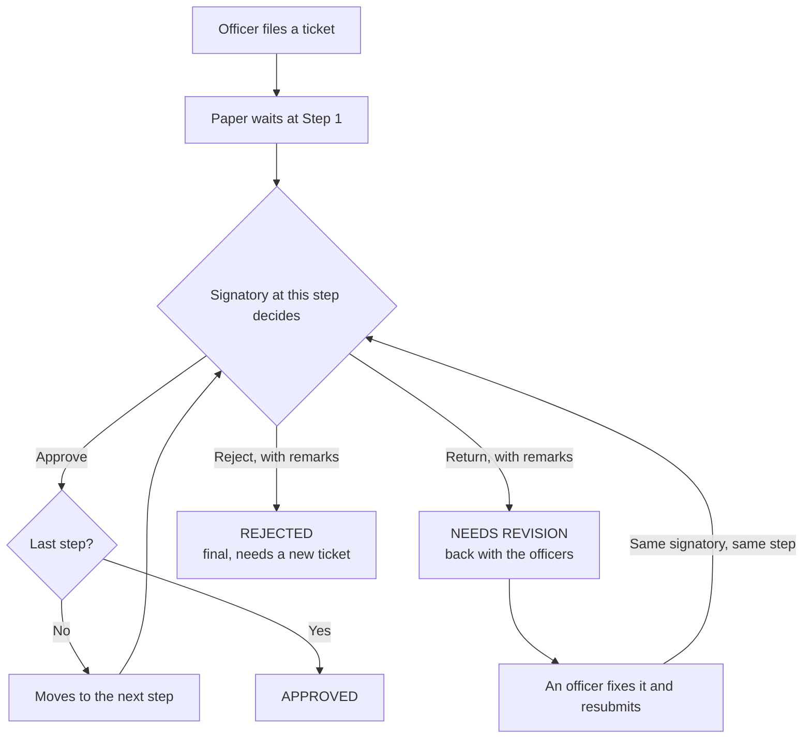

**Three rules to remember:**
1. **Order is strict.** Only the signatory at the paper's current step can act on it.
2. **Return keeps your progress.** The paper comes back to the same signatory, and earlier approvals stay valid.
3. **Reject is final.** The officer has to file a new ticket.

### A Batch can split

Each paper moves on its own, so a ticket can be in several places at once:

```text
Ticket DM-2026-00123 "DIGITS Week"
├─ Resolution         Adviser ✔  SSC ✔  ODSOA ✔  VPSD ✔    → APPROVED
├─ Activity Proposal  Adviser ✔  SSC ↩ returned, fixed, back to SSC ✔ ...
└─ Budgetary          Adviser ✔  SSC ✖                     → REJECTED
```

### The ticket's overall status

It's worked out from its papers and never stored. DOC-MON checks in this order:

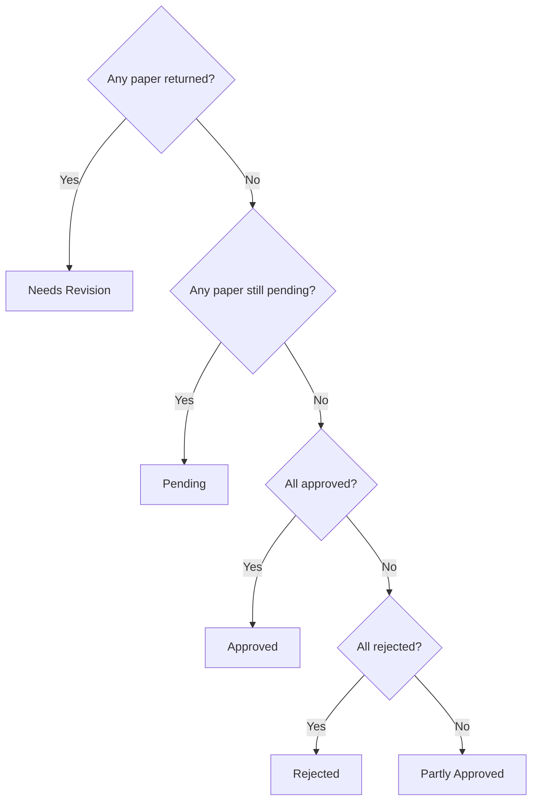

---

## 7. What happens when a signatory clicks Approve

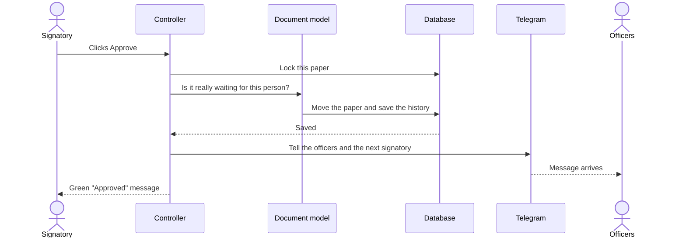

**Why the lock?** If someone double-clicks, or has two tabs open, the second click waits. It then sees the paper already moved, and stops.

**Why does Telegram come last?** The approval is saved first, so a Telegram failure can't undo it.

---

## 8. Live updates

Officer pages update without a refresh. The page doesn't re-download everything every time. It first asks a tiny question:

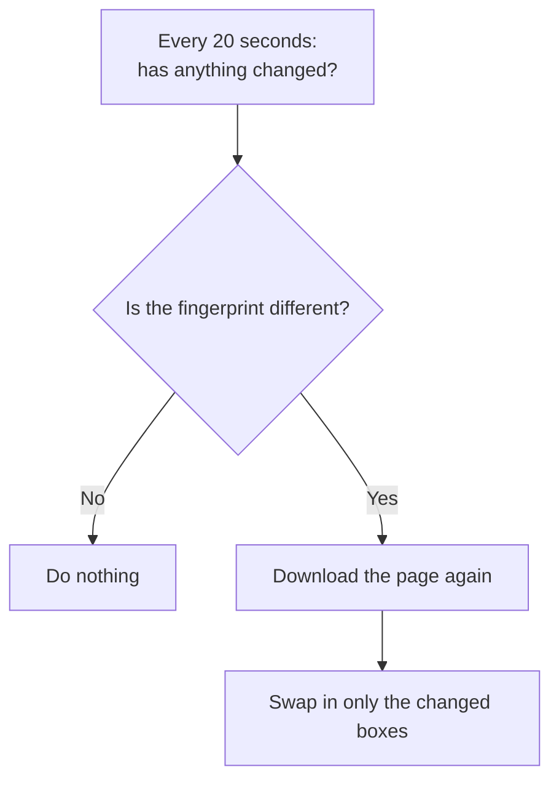

The **fingerprint** is a short code made from the route, the availability and where each paper is. If any of those change, the code changes. It only runs while the tab is visible.

---

## 9. Connecting Telegram

Telegram won't let a bot message a stranger first, so the user has to press **Start**:

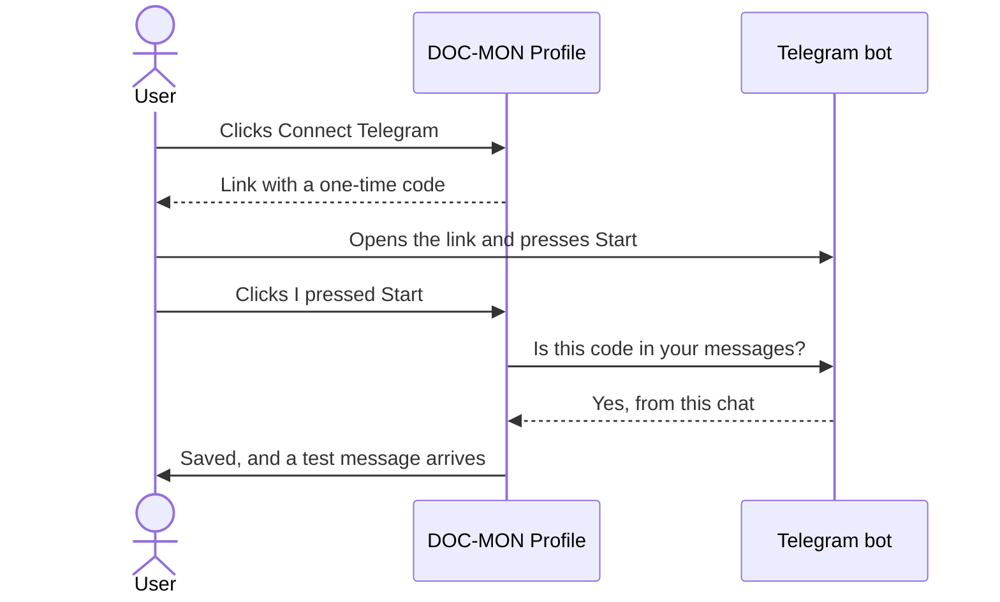

**Who gets what:**

| What happened | Who gets a message |
|---|---|
| Ticket submitted | The first signatory |
| Paper approved | All officers of the organization, and the next signatory |
| Final approval | All officers of the organization |
| Returned or rejected | All officers of the organization, with the remarks |
| Resubmitted | The same signatory |

---

## 10. Forgot password

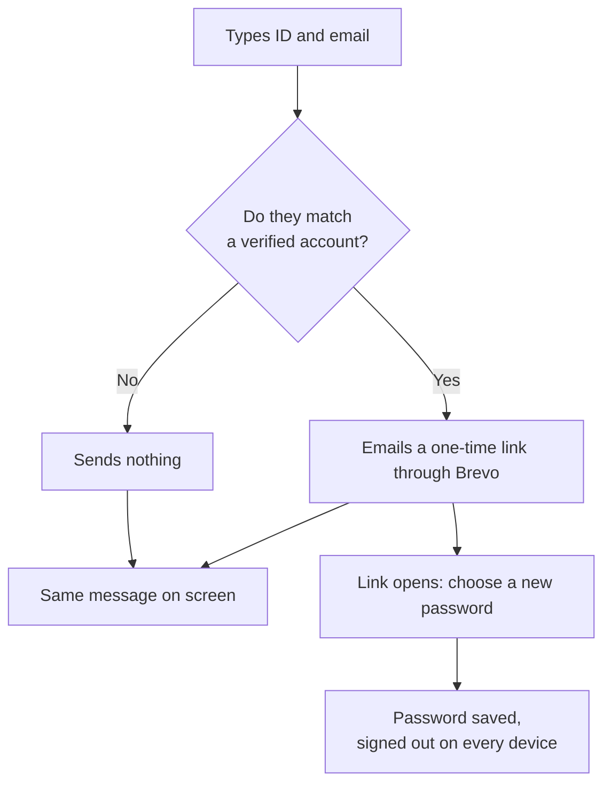

The screen always says the same thing, so strangers can't use the form to find out which accounts exist. The link works **once** and expires in **60 minutes**.

### Passwords and log-ins

- A password needs **8+ characters with letters and numbers**, and can't be one from a known data leak.
- Log-in allows **5 tries a minute** per internet address and **10 a minute** per account.
- Every log-in, failed or not, goes into the **Activity Log**, but never the typed password.
- Changing your password **signs out your other devices**.

---

## 11. How the data connects

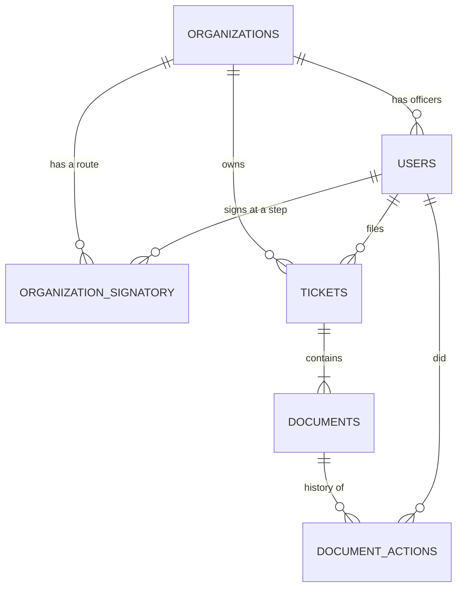

| Table | Holds |
|---|---|
| `users` | Everyone, with a role and a status |
| `organizations` | Student organizations |
| `organization_signatory` | The route: who signs at which step |
| `tickets` | One request, with its Ref No. |
| `documents` | Each paper, with its own status and step |
| `document_actions` | Every approve, return, reject and resubmit |
| `id_documents` | ID photos, only until the admin's review |
| `activity_logs` | Important actions, for the admin to read |

---

## 12. How a change reaches the live site

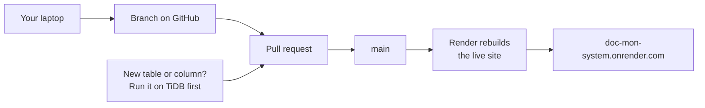

The code updates **by itself**, but the database **doesn't**. A new migration has to run on TiDB **before** the merge, or the live site crashes. See [DEPLOY.md](DEPLOY.md).

---

## 13. Where do I look?

| I want to change... | Go to |
|---|---|
| A page or URL | `routes/web.php` |
| How a page looks | `resources/views/`, `public/css/` |
| The approval rules | `app/Models/Document.php` |
| A ticket's status or search | `app/Models/Ticket.php` |
| Telegram messages | `app/Services/TicketAlerts.php` |
| The privacy notice | `resources/views/privacy.blade.php` |
| The reset email | `app/Notifications/ResetPasswordNotification.php` |
| A table | a **new** file in `database/migrations/` |

---

## 14. Words to remember

| Word | Meaning |
|---|---|
| **Route** (approval) | An organization's ordered signatories |
| **Route** (web) | A URL mapped to a controller. Same word, different thing |
| **Step** | A position on the approval route |
| **Holder** | Who has a paper right now |
| **Migration** | A file that changes the database structure |
| **Middleware** | A check that runs before the controller |
| **CSRF token** | A hidden code proving a form came from DOC-MON |
